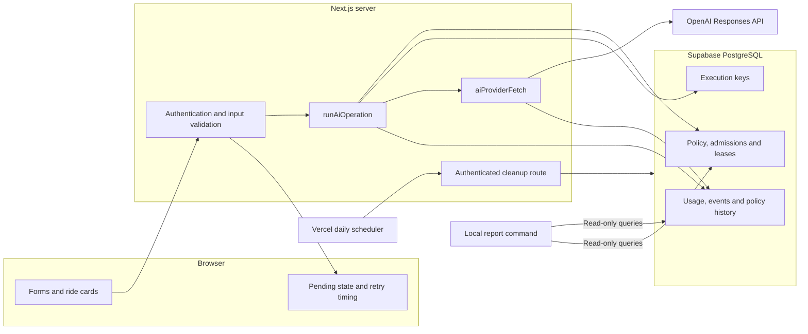

# AJDE-34: how AI admission, execution and accounting work

Implementation walkthrough · 2026-11-15

This document explains the implementation in local commit `3994683`, including the decisions,
database changes, server code, browser behavior, and operational limits. It describes the code as
implemented, rather than treating every item in the original plan as a deployed production feature.

**Delivery status:** the implementation is committed locally. The owner chose not to push or open
a PR. Production migrations and deployment have not been performed. Monetary alert/cutoff values
remain unset at the owner's request. The generated usage report so far contains local validation
data, not measured production costs.

The maintained operational reference is [AI_RATE_LIMITING.md](AI_RATE_LIMITING.md). The source of
truth for enforcement is the SQL migrations and server code linked below; this walkthrough is an
explanation, not another configuration file.

## Contents

1. [What changed and why](#1-what-changed-and-why)
2. [Actions, model calls and tokens](#2-actions-model-calls-and-tokens)
3. [Where each part runs](#3-where-each-part-runs)
4. [Database changes](#4-database-changes)
5. [How one admission is decided](#5-how-one-admission-is-decided)
6. [Server execution and deadlines](#6-server-execution-and-deadlines)
7. [Preventing duplicate paid work](#7-preventing-duplicate-paid-work)
8. [Integration with each AI feature](#8-integration-with-each-ai-feature)
9. [Provider limits and token accounting](#9-provider-limits-and-token-accounting)
10. [Cost estimates and monetary controls](#10-cost-estimates-and-monetary-controls)
11. [Browser recovery and automatic explanations](#11-browser-recovery-and-automatic-explanations)
12. [Reporting and retention](#12-reporting-and-retention)
13. [Security and failure behavior](#13-security-and-failure-behavior)
14. [What was verified](#14-what-was-verified)
15. [Deployment and future changes](#15-deployment-and-future-changes)
16. [Code map and glossary](#16-code-map-and-glossary)

## 1. What changed and why

The app already had AI search, import, interpretation, chat assistance, note translation and match
explanations. This work did not create all of those features. It added a shared control layer around
their paid work, bounded their internal requests, and added measurements needed to understand cost.

Before this change, chat had a dedicated `try_chat_ai_request()` guard allowing five requests per
rolling minute. That was not a shared allowance covering search, screenshot reading and the other
AI entry points. UI button disabling alone also could not coordinate different tabs, direct HTTP
requests, or different application-server instances.

| Problem | Implemented response | Reason |
| --- | --- | --- |
| Repeated AI actions across several features | A shared per-user rolling-hour policy in PostgreSQL | All application instances consult the same durable state. |
| Repeated screenshot processing | An additional screenshot sublimit within the shared allowance | Reading images has its own frequency control without a separate visible credit system. |
| Rapid consecutive clicks | A fractional token bucket | Smooths short bursts independently of the hourly total. |
| Several long operations running together | Expiring operation leases | Counts work in progress and recovers from crashed servers. |
| Duplicate delivery of one action | Database-backed execution claims | An in-memory lock or disabled button cannot coordinate multiple servers. |
| One request multiplying into many paid calls | Per-feature round limits, token caps, timeouts and disabled SDK retries | The top-level request count alone does not bound internal work. |
| Unclear actual cost | Per-provider-attempt usage metadata and versioned estimates | Distinguishes frequent actions from expensive pipelines. |
| Users losing work after a denial | A shared browser recovery helper | Keeps input/uploads and allows a deliberate later retry. |
| Metadata growing indefinitely | A daily authenticated cleanup job | Retains useful reporting history without keeping user measurements forever. |

The old chat budget table/function remain for compatibility with older deployments. The new chat
code no longer calls that guard, so a new chat action is not charged by both limiters.

## 2. Actions, model calls and tokens

These are three different units:

| Unit | Meaning | Example |
| --- | --- | --- |
| Action / operation | One admitted top-level AI request | Clicking “Create review draft” for a pasted post. |
| Provider call | One HTTP request to the model provider inside that operation | The initial parser, a location fallback, or one checker round. |
| Tokens | Provider-reported input/output usage for an individual call | The combined prompt, model response, and any reported cached input. |

An import operation can contain several provider calls while consuming one action admission.
Their token usage is still recorded individually and grouped under that operation's ID.

### The starting policy

| Control | Explicit actions | Automatic explanations |
| --- | --- | --- |
| Admissions in the previous rolling hour | 30, shared across explicit features | 60, in a separate group |
| Screenshot reads within that hour | At most 10 of the shared 30 | Not applicable |
| Burst bucket | Capacity 4; one permit refilled per 10 seconds | No burst bucket configured |
| Concurrent operations | 2 | 2 independently |
| Default legal operation duration | 120 seconds | 120 seconds |
| Default crash-recovery lease | 180 seconds | 180 seconds |

The explanation allowance does not consume the explicit allowance. Likewise, its two concurrency
slots are separate. Concurrency counts operations, not individual model HTTP requests.

These numbers were supplied in the implementation plan. They are initial anti-spam settings,
not thresholds calculated from production usage or a launch-dollar budget. Token prices were
researched for accounting; they did not establish why the hourly action limit is exactly 30.

### What 10 screenshots means

Screenshot reading and text parsing are separate requests in the current UI:

```text
Read one uploaded screenshot       -> 1 explicit action + 1 screenshot admission
Select a detected post            -> no AI action
Parse the selected post           -> 1 further explicit action
Review/edit the resulting draft   -> no AI action merely for editing
```

Therefore, 10 screenshot reads followed by 10 post-parsing requests consume 20 explicit actions,
leaving 10 of the 30. The screenshot allowance is a subset of 30, not 10 extra actions.

One screenshot read can return up to ten detected posts. They are not all automatically imported;
the user selects a post and explicitly requests parsing. Parsing another post is another action.

### Why requests do not define a fixed cost

A search can use one model call plus up to two location fallbacks. A text import can use up to
eight provider attempts: one parser, two location fallbacks and up to five checker rounds. Reading
a screenshot and then parsing its text could therefore involve up to nine provider attempts
across two admitted actions. This is an execution bound, not a prediction that every import uses
that many calls.

Failed provider work, refusals and cancellation do not refund a successful admission. Otherwise,
repeated failures could become a way to bypass the frequency control.

## 3. Where each part runs



| Location | Responsibilities | What it does not decide |
| --- | --- | --- |
| Browser React components | Preserve inputs, prevent duplicate submission while pending, create request UUIDs, display retry time, render cards | Trusted identity, allowance sizes, policy groups, cost, or admission. |
| Next.js routes and server actions | Authenticate, authorize, validate, run the operation wrapper, call helpers, map errors | They do not maintain the shared rolling window in process memory. |
| PostgreSQL RPCs | Atomically admit, coordinate claims, retain operation/lease state, restrict privileged mutations | They do not call OpenAI or hold a database transaction open while a model runs. |
| Provider transport | Check execution bounds, send the model request, capture response usage | It does not decide business access to a ride or chat room. |
| Vercel cron route | Authenticate the scheduler and invoke retention cleanup | It does not refill burst permits or reset hourly budgets. |
| Local report CLI | Read central metadata, compute aggregates, write an ignored local Markdown report | It does not alter enforcement policy or execute model calls. |

The implementation uses Node's `AsyncLocalStorage`. It carries one operation context through
asynchronous helper calls in the current server process. PostgreSQL provides cross-instance
coordination; `AsyncLocalStorage` is not the shared rate-limit database.

## 4. Database changes

Three migrations introduce eight tables and the associated functions, indexes, privileges and
cleanup behavior. The later migrations replace the cleanup function to cover the additional data.

| Migration | Main purpose |
| --- | --- |
| [20261114213947_ai_admission_leases.sql](../ride-share-app/supabase/migrations/20261114213947_ai_admission_leases.sql) | Policy configuration, feature mapping, fractional burst state, admission history and leases. |
| [20261114221211_ai_execution_keys.sql](../ride-share-app/supabase/migrations/20261114221211_ai_execution_keys.sql) | Request-key claims, operation binding, generation-safe completion and claim cleanup. |
| [20261114221935_ai_usage_accounting.sql](../ride-share-app/supabase/migrations/20261114221935_ai_usage_accounting.sql) | Provider usage, request events, policy history, rolling spend aggregation and final retention logic. |

### 4.1 `ai_admission_policies`: the executable policy

Each row describes one group, `explicit` or `explanation`. Columns include hourly allowance,
optional screenshot allowance, optional burst capacity/refill interval, concurrency, legal operation
duration, lease lifetime and effective time.

Database constraints reject invalid configurations:

- Hourly limits: 1–10,000.
- Screenshot sublimit: null, or 1 through that group's hourly limit; explanations cannot have one.
- Burst capacity: null, or 1–100; refill interval: null, or 1–3,600 seconds. Both must be set or both null.
- Concurrent operations: 1–20.
- Operation duration: 1–300 seconds.
- Lease lifetime: at least operation duration + 30 seconds, and at most 600 seconds.

Changing the UI or sending a different JSON field cannot change these values. They are changed
through reviewed migrations. The browser is not allowed to edit the policy table.

### 4.2 `ai_admission_features`: feature-to-group mapping

This table maps `search`, `parse`, `screenshot`, `interpret`, `chat_assist` and `translate_notes` to
`explicit`, and maps `explain` to `explanation`. Server routes pass their own constant feature name.

The mapping avoids accidentally giving every endpoint its own separate 30-action allowance. It
also prevents the browser from choosing a cheaper policy group for an expensive endpoint.

### 4.3 `ai_admission_buckets`: fractional burst state

The primary key is `(user_id, policy_group)`. A row stores the remaining fractional `permits` and
the database time `refilled_at`. User deletion cascades to this table.

Refill is calculated from elapsed database time when admission is checked. There is no refill job
running every ten seconds. A successful admission saves the updated fractional amount after
consuming one permit. A denied admission does not rewrite or consume the bucket.

### 4.4 `ai_operations`: admission history and the lease in one row

An operation row contains:

| Column | Purpose |
| --- | --- |
| `id` | Server-generated UUID identifying the admitted operation. |
| `user_id` | Owning Supabase Auth user; account deletion cascades. |
| `policy_group`, `feature` | Which allowance and feature were charged. |
| `admitted_at` | The durable rolling-window charge. |
| `deadline_at` | End of the legal paid-work duration. |
| `lease_expires_at` | Crash-recovery time after which the row no longer occupies concurrency. |
| `released_at` | Normal completion/error cleanup; null while not explicitly released. |

The row stays in hourly counting after release. Completing a request frees concurrency, not its
hourly charge. Lease expiry also does not refund an admission.

Indexes support different questions without scanning all users' history:

| Index | Query it supports |
| --- | --- |
| `(user_id, policy_group, admitted_at)` | Recent admissions for that user and allowance. |
| `(user_id, admitted_at) WHERE feature = 'screenshot'` | Screenshot subset counting. |
| `(user_id, policy_group, lease_expires_at) WHERE released_at IS NULL` | Live concurrency and retry timing. |
| `(admitted_at)` | Retention cleanup. |

### 4.5 `ai_execution_keys`: deduplication state

The primary key is `(user_id, request_id)`. The row stores a unique `claim_id`, the feature, a
64-character HMAC input fingerprint, an optional bound `operation_id`, expiry and completion time.

The claim UUID distinguishes two generations that happen to reuse the same request UUID after
expiry. A late callback from the old generation cannot complete the new claim.

Keys initially expire after ten minutes. Binding an operation extends expiry, if needed, to at
least one minute after that operation's lease expires. A delayed admission must not leave a live
operation with an already-expired duplicate-protection key.

Account deletion cascades. If an operation is deleted, the optional reference is set null. An
expiry index supports cleanup. This table does not contain prompts or cached generated answers.

### 4.6 `ai_provider_usage`: one row per captured provider attempt

Each row has its own UUID and links to the originating operation, user and feature. It stores
requested and actual model, nullable input/cached-input/output counts, duration, outcome, price
version, nullable estimated USD cost and recording time.

The actual model comes from the provider response. The requested model is retained separately;
requesting a known model does not make missing actual-model information known.

Constraints reject negative tokens/costs and cached tokens exceeding input tokens. A non-null cost
requires model and token fields. The primary key rejects duplicate rows with the same attempt UUID.
Indexes support operation aggregation and reporting by recording time/feature. Operation and Auth
user deletion cascade to usage rows.

### 4.7 `ai_request_events`: admission failures and operation outcomes

This contains user, feature, optional operation, outcome, short reason, duration and recording time.
It records quota denial, limiter-store errors, completed/failed/timed-out/cancelled work, and service
stops. An operation reference is optional because a denied request has no admitted operation.

Events are written by the server wrapper, not directly by the admission RPC. In particular, a
direct caller consuming/denying its own RPC allowance does not automatically produce the same
server event stream as an application endpoint. The operations ledger remains authoritative for
successful admissions.

If an operation is deleted, its event reference is set null. Auth account deletion cascades. A
recording-time/feature/outcome index supports reports and retention.

### 4.8 `ai_policy_versions`: historical configuration

Each row has a group, effective timestamp and JSON policy snapshot. Initial policy rows are copied
when the accounting migration runs. The `record_ai_policy_version()` trigger records policy updates
and stamps their effective time using the database clock.

This lets a later cost/usage review see which settings existed, rather than only today's numbers.
It contains configuration, not user measurements, and is retained independently of the 35-day
measurement cleanup. It is not a record of arbitrary source posts or model prompts.

### Database functions and permissions

| Function | Caller | Main job |
| --- | --- | --- |
| `admit_ai_operation(feature)` | Authenticated user's client | Derive `auth.uid()`, atomically check all constraints, and create an operation on success. |
| `claim_ai_execution(request_id, feature, input_hash)` | Authenticated user's client | Atomically claim or classify a duplicate request for `auth.uid()`. |
| `bind_ai_execution(request_id, user_id, operation_id, claim_id)` | Server service role | Bind only a matching live operation and claim generation; extend key expiry. |
| `finish_ai_execution(request_id, user_id, claim_id)` | Server service role | Idempotently complete that generation. |
| `release_ai_operation(operation_id, user_id)` | Server service role | Release only the matching operation/owner without deleting its charge. |
| `ai_spend_last_day()` | Server service role | Read known cost subtotal and unknown-cost call count over the last 24 hours. |
| `cleanup_ai_operations()` | Server service role | Delete expired/old metadata according to retention. |
| `record_ai_policy_version()` | Policy-update trigger | Preserve configuration history; not an API entry point. |

All eight new tables enable RLS and deny direct `anon`/`authenticated` table access. No permissive
user policies are added: users consume capacity through the intended RPCs instead of editing rows.
Functions revoke default public execution and receive explicit grants. Privileged functions use
fixed empty search paths and schema-qualified references. Admission/claim functions derive the
caller from the authenticated database session, not a browser-supplied user ID.

The server-only admin client remains powerful. It is used narrowly here for metadata, release,
binding/completion, cleanup and aggregate spend. Ride and room data access still uses the user's
client and existing authorization rules.

## 5. How one admission is decided

Source: [admission migration](../ride-share-app/supabase/migrations/20261114213947_ai_admission_leases.sql)
and [typed adapter](../ride-share-app/lib/ai/admission.ts).

The RPC first checks identity and loads the server-owned feature/group policy. It then takes:

```sql
pg_advisory_xact_lock(hashtextextended(actor::text, 34))
```

This transaction-level lock serializes admissions for the same user, including the first request
before any bucket/state row exists. It is not a global lock across all users. Explicit and explanation
admission checks for one user serialize briefly but retain separate counters and leases.

The database clock is sampled after obtaining the lock. Time spent waiting must not make the
rolling-window or lease check use a stale pre-lock instant.

### Rolling-hour counting

The predicate is strictly:

```sql
admitted_at > checked_at - interval '1 hour'
```

An action admitted at 10:15 stops counting at 11:15. It does not reset at 11:00. Different rows expire
individually. Released operations still count until their own admission timestamp leaves the window.

For screenshots, the RPC also counts recent rows whose feature is `screenshot`. One successful
screenshot admission participates in both the shared count and the screenshot subset.

### Fractional burst refill

Conceptually:

```text
available = min(capacity, savedPermits + elapsedSeconds / refillSeconds)
```

With the defaults, an empty bucket gains 0.5 permit after five seconds and one permit after ten.
Idle time never accumulates more than four. Admission requires at least one full permit and then
subtracts one, preserving any fractional remainder.

Four burst permits do not allow four long operations to run together: the separate concurrency
limit still allows only two explicit operations at a time.

### Live-operation counting

An operation occupies concurrency only while:

```text
released_at is null AND lease_expires_at > checked_at
```

A normal release immediately stops it occupying a slot. A crashed server does not need to execute
a cleanup callback for the lease eventually to stop counting.

### One transaction decides the result

All constraints are checked before inserting an operation or consuming a burst permit. If any
constraint is exhausted, the RPC returns denial without an additional action charge, bucket
mutation, or lease. If all pass, it consumes the burst permit and inserts the operation atomically.

For a user at 29 admissions, two competing requests cannot both see 29 and both become number 30.
The first check/insert completes under the lock; the next sees the updated state.

### Retry time is the longest wait

The RPC calculates when each exhausted constraint could allow admission and returns the latest
of those times. Waiting only for the shortest constraint would still leave the request blocked.

For concurrency it conservatively uses lease expiries, because the database cannot predict when a
server will finish and release. The user may technically become eligible sooner if work finishes,
but the UI does not poll or repeatedly attempt to discover that.

If an operator lowers a limit below retained usage, the RPC waits for enough rows/leases to expire,
not just the earliest one. The selected ordered offset accounts for the excess above the new limit.
`retryAfterSeconds` is rounded up from the same database clock. This is an eligibility hint, not a
reservation: another request may consume capacity before a later retry.

The database transaction ends before OpenAI is called. The lease row, rather than an open SQL
transaction or long-held advisory lock, represents the ongoing model operation.

## 6. Server execution and deadlines

Source: [operation.ts](../ride-share-app/lib/ai/operation.ts) and
[operation-context.ts](../ride-share-app/lib/ai/operation-context.ts).

The intended route pattern is:

```ts
// Authentication, access checks, request validation and required data loading happen first.
const result = await runAiOperation(
  {
    supabase,              // authenticated user's client
    userId: user.id,        // established on the server
    feature: "search",     // endpoint-owned constant
    signal: request.signal,
    ...aiRequestIdentity(request, validatedInput),
  },
  () => parseSearchQuery(validatedInput.query, context),
);
```

The example illustrates the existing pattern; it is not a standalone copy-paste route.

The wrapper performs these stages:

1. Check the kill switch, provider key, incoming cancellation and required admin configuration.
2. Check configured monetary controls; an already-active cutoff should not consume a new admission.
3. If a request UUID is supplied, validate/fingerprint it and claim execution.
4. Call the authenticated admission RPC and validate its JSON result with Zod.
5. Build an operation context and timer; bind a claimed key to the admitted operation before work.
6. Run the callback inside `AsyncLocalStorage` so nested model helpers inherit the context.
7. Check deadline/service-stop state after work, rather than trusting a helper that swallowed an error.
8. In `finally`, close/abort the context, record the operation outcome and attempt lease release.
9. Complete the request-key generation in an outer `finally`, when applicable.

The context carries operation ID, user ID, feature, abort signal, deadline, call count, and closed/
service-unavailability state. Helpers do not each obtain another action permit.

### Why the deadline uses a monotonic duration

Simply comparing the app's wall clock with a database timestamp would depend on the two machines'
clocks agreeing. The implementation instead calculates:

```text
database duration = deadlineAt - admittedAt
remaining budget  = database duration - entire measured admission RPC round trip
local expiry      = performance.now() + remaining budget
```

Subtracting the whole RPC round trip is conservative, including lock waits. The local monotonic
clock is then used to reject expired provider starts, avoiding extension by ordinary wall-clock
adjustments. A timer aborts the operation signal when the remaining budget ends.

The 120-second default is a bound on legal paid execution, not a promise that every HTTP response
returns within exactly 120 seconds. The wrapper awaits its callback rather than forcibly terminating
arbitrary JavaScript promises; non-provider database work and best-effort bookkeeping may take
additional time. Some lifecycle RPCs do not have their own explicit client abort timeout.

### Why the lease lasts longer

The default legal operation duration is 120 seconds and the lease is 180 seconds. The gap allows
crash recovery without allowing a still-legal operation to start more paid work after its concurrency
slot is reclaimed. Policy constraints require a margin of at least 30 seconds.

Normal cleanup runs after the callback settles. A `Promise.race` that immediately released on an
abort timer could allow the original callback to continue while a new request used its freed slot.
Instead, cancellation signals propagate to provider requests, and closed/expired contexts reject
any later paid start, including background asynchronous work retaining the context.

Cancellation cannot guarantee that a request already received by OpenAI is unbilled. If the
response/usage is lost, its billable amount remains unknown rather than zero.

## 7. Preventing duplicate paid work

Source: [execution-key migration](../ride-share-app/supabase/migrations/20261114221211_ai_execution_keys.sql)
and [operation.ts](../ride-share-app/lib/ai/operation.ts).

Four UUIDs have different jobs:

| Identifier | Created by | Meaning |
| --- | --- | --- |
| Request UUID (`Idempotency-Key` / `requestId`) | Browser/caller | One intentional submission whose duplicate deliveries should be coordinated. |
| Claim UUID (`claim_id`) | Database | The generation currently owning that request key. |
| Operation UUID (`ai_operations.id`) | Database admission | The admitted action, its charge, deadline and lease. |
| Provider-attempt UUID (`ai_provider_usage.id`) | Server accounting | One recorded provider attempt/round under that action. |

Browser HTTP submissions include an `Idempotency-Key` UUID. The translation action supports an
optional `requestId`. The server recursively orders input object keys and HMAC-SHA256 hashes
normalized `{ feature, input }` using its service secret. Only the fingerprint is stored.

The normalized material varies by feature: screenshot identity includes an image-byte digest and
MIME type; explanation identity includes locale/context; chat includes the request, transcript cutoff
and locale; note translation includes the current stored source. A different source or context must
not silently count as the same operation.

| Existing claim for this user/key | Result | Paid work |
| --- | --- | --- |
| None, or expired | `claimed`, with a new generation UUID | May proceed to admission and binding. |
| Same feature/input, unfinished | `pending` | No new admission or model call; HTTP endpoints return 202. |
| Different feature or fingerprint | `conflict` | No new admission or model call; HTTP 409. |
| Same request already completed | `completed`, mapped to conflict | No result replay or new paid work; HTTP 409. |

Binding checks that the operation belongs to the user, matches the feature, is not released, and
is still within its database deadline. It also checks the exact claim generation. A failed bind stops
paid work; the admitted lease is still released in `finally` where possible.

The stored claim contains no generated-result cache. A deliberate retry creates a new request UUID
and may consume another action. Authorization is checked before claiming and before sensitive
results are returned; there is no server-side cached response to replay around fresh access checks.

**Scope of this guarantee:** request keys are optional at the server boundary and expire after a
short retention period. Requests without keys, or intentional submissions with different keys,
are separate actions subject to the normal limits. This is not permanent content deduplication,
not an eternal exactly-once provider-billing guarantee, and not general idempotency for every
business write in the application.

## 8. Integration with each AI feature

The existing features keep their route-specific access checks; the new wrapper surrounds paid
work after those checks. Admission is not a replacement for authorization.

| Entry point | Feature/group | Work covered by one admission | Existing checks and fast paths |
| --- | --- | --- | --- |
| `POST /api/search` | `search` / explicit | Query interpretation and location fallbacks | Authenticated approved student, required profile fields, 2–300-character query, loaded city/pickup catalogs. |
| `POST /api/parse` | `parse` / explicit | Post parser, location resolution, optional checker rounds, and saving the import result | Authenticated user, 10–5,000-character post, valid source hint and loaded catalogs. Checker remains controlled by the import-pipeline flag. |
| `POST /api/parse/screenshot` | `screenshot` / explicit | One image-reading model call | Import-pipeline flag, authentication, exactly one supported multipart file, nonempty PNG/JPEG/WebP up to 4 MiB. |
| `POST /api/rides/interpret` | `interpret` / explicit | Interpret an offer description into editable trip drafts | Existing offer API access context, validated 2–6,000-character input and loaded location/car catalogs; at most four returned trips. |
| `POST /api/chat/assist` | `chat_assist` / explicit | One grounded room-assistance request | Existing feature flag, same-origin HTTP request, 8 KiB body cap, room membership, bounded server transcript, account/access checks before and after work, validated citations. |
| `translateRideNotes()` server action | `translate_notes` / explicit | Translate the accessible stored note | Complete profile, approved student, valid ride/locale, ride/booking access and source length; re-read access/source before returning output. |
| `POST /api/explain` | `explain` / explanation | One optional batch of ride-card explanations | Approved student/profile, at most 24 ride IDs, server-fetched eligible ride facts, search-context matching and locale. Empty/no-fact requests skip paid work; missing-key local-template path consumes no permit. |

Chat no longer uses the old hardcoded five-per-minute budget or an unconditional 60-second
`Retry-After`. Provider throttling has a separate chat error code from application quota denial.
The note action reads the stored note, not a client-supplied replacement source; if access is lost
or the source changes during translation, the generated result is discarded.

### A screenshot-to-import flow

```mermaid
sequenceDiagram
    participant U as Browser/user
    participant S as Next.js server
    participant D as PostgreSQL
    participant P as OpenAI
    U->>S: Screenshot upload with request key A
    S->>S: Validate flag, user and file
    S->>D: Claim A, admit screenshot, bind operation
    alt Denied
        D-->>S: Reason and retry timing
        S-->>U: 429; original file remains available
    else Admitted
        S->>P: Read image under operation context
        P-->>S: Detected posts and usage
        S->>D: Record usage; release lease; finish claim
        S-->>U: Detected posts
    end
    U->>U: Select one post and request parsing
    U->>S: Text parse with request key B
    S->>D: Claim B, admit parse, bind new operation
    S->>P: Parser, optional fallbacks/checker rounds
    P-->>S: Structured results and per-call usage
    S->>D: Save import; account; release; finish
    S-->>U: Editable review draft
```

The diagram groups several separate RPCs for readability. Only each admission/claim RPC is atomic;
the provider call and subsequent import save are not one distributed database transaction. The
import still uses its existing `imports.raw_text` business-data storage. The new accounting tables
do not duplicate that source text.

### What automatic explanations are

These are optional sentences on result cards explaining a ride's fit to the search, such as its
route or departure time. They are not the search engine deciding which rides match. The server
loads and checks the ride facts before asking for wording, and existing explanation validation/
local factual templates remain in place.

One request can explain up to 24 cards and consumes one explanation admission, not 24. It does
not consume any of the 30 explicit actions. If admission is denied, the UI keeps complete cards
without optional explanations. A missing API key can use local templates without a model call.

## 9. Provider limits and token accounting

### All paid HTTP traffic goes through one transport

Every OpenAI SDK client supplies `aiProviderFetch` as its fetch implementation. The location
fallback previously used a direct HTTP request; it now also uses this transport. This matters
because protecting only SDK calls would leave that fallback outside operation bounds/accounting.

The transport checks context, kill switch, cancellation, expiry, call count and serialized input
size. If monetary controls are configured it checks them, then rechecks deadline/call state after
that asynchronous database round trip before starting a provider request.

In production, a call without an operation context is rejected. Standalone helper testing/evaluation
outside production can run without a user context; normal application routes still use the wrapper.

### Provider bounds

| Provider component | Output-token cap per call | Per-call timeout | Role in the operation |
| --- | ---: | ---: | --- |
| Search interpreter | 1,800 | 10 s | Main search call. |
| Ride-post parser | 4,000 | 20 s | Main text-import call. |
| Direct location fallback | 1,500 | 10 s | Optional location lookup; default model is configured separately. |
| Draft checker | 3,000 | 15 s | Up to five checker rounds. |
| Screenshot reader | 6,000 | 15 s | One image-reading call. |
| Offer interpreter | 8,000 | 20 s | One interpretation call; at most four trips returned. |
| Chat assistant | 3,000 | 30 s | One grounded room response. |
| Note translation | 2,000 | 15 s | One translation of stored notes. |
| Match explanation | 4,000 | 10 s | One batch of up to 24 cards. |

Search has at most three provider attempts per operation, parse at most eight, and each remaining
feature at most one. All SDK clients explicitly use `maxRetries: 0`; SDK logging is set to `off`
to avoid enabling raw SDK request/response diagnostics through normal logging configuration.

The checker also permits at most six executed tools across its rounds, with a bound of 32 returned
function-call records in one round. Tool executions such as routing/database lookups are different
from the model requests that ask for or consume their results.

Serialized provider request bodies are capped at 256 KiB, or 6 MiB for screenshot data URLs. This
also bounds catalog/tool-history payloads, not only typed user text. The upload cap is separately
4 MiB; its encoded provider payload is larger. Chat retains its existing 1,000-message/100,000-
character transcript bounds. Notes use the existing 2,000-character source limit.

These are not universal HTTP-upload or denial-of-service limits for the whole application. For
example, the provider-body cap happens at transport time, and not every endpoint has the chat
route's streaming HTTP body cap. General endpoint/IP protection is outside AJDE-34's scope.

### Capturing usage before parsing

After a provider response arrives, the transport clones it and inspects JSON usage before returning
the original response to the SDK/parser. If parsing the generated result fails afterwards, the
provider's successful billable response has already been accounted for where persistence succeeded.

```text
provider response
  -> read a clone for actual model / usage / status
  -> persist metadata with the originating operation ID
  -> return original response to SDK parsing and feature validation
```

Actual input/output counts are preserved when available. Missing cached input remains unknown;
it is not assumed to be zero. Invalid counts do not become invented usage. Reasoning tokens are
not added again to output, because reported output already includes them.

Accounting writes have a five-second abort bound and catch/log their own failures. They do not
rerun the provider call. Network cancellation, a lost response or a crash can leave billable usage
unknown. Complete/failure operation events and provider-attempt outcomes are separate measurements:
a successful provider response can still belong to an application operation that later failed.

## 10. Cost estimates and monetary controls

Source: [pricing.ts](../ride-share-app/lib/ai/pricing.ts),
[accounting.ts](../ride-share-app/lib/ai/accounting.ts), and
[spend-control.ts](../ride-share-app/lib/ai/spend-control.ts).

### Price snapshot used by this implementation

The version is `2026-11-14-standard-v1`, with USD rates per million tokens:

| Model family / recognized snapshot | Uncached input | Cached input | Output |
| --- | ---: | ---: | ---: |
| `gpt-5.4-mini` / `gpt-5.4-mini-2026-03-17` | 0.75 | 0.075 | 4.50 |
| `gpt-5-mini` / `gpt-5-mini-2025-08-07` | 0.25 | 0.025 | 2.00 |

These are the rates encoded in this historical configuration, checked against the linked official
model pages during implementation. They are not a promise that future model pricing stays fixed.
The reference links are in `pricing.ts`; changes require a reviewed price configuration update.

The formula is:

```text
estimated USD = (
  (inputTokens - cachedInputTokens) * uncachedInputRate
  + cachedInputTokens * cachedInputRate
  + outputTokens * outputRate
) / 1,000,000
```

For the test example of 1,000 input tokens, 400 cached input and 200 output on GPT-5.4 mini, the
estimate is `(600 * 0.75 + 400 * 0.075 + 200 * 4.50) / 1,000,000 = $0.00138`. This illustrates
the arithmetic; it is not a measured average search, screenshot or import cost.

Unknown actual models, missing required usage, unrecognized snapshots, and unpriced service tiers
leave estimated cost null. Only the standard/default service tier is priced here. Each usage row
stores the price version used, so a later configuration update does not silently reprice old rows.

### Optional monetary controls

| Setting | Behavior |
| --- | --- |
| `AI_SPEND_ALERT_USD` | Warn when known aggregate cost in the previous rolling 24 hours reaches the threshold. |
| `AI_SPEND_CUTOFF_USD` | Stop new operations/provider rounds once that known subtotal reaches the threshold. |
| `AI_SPEND_POLICY_EFFECTIVE_AT` | Required valid ISO timestamp when either monetary threshold is configured. |
| `AI_KILL_SWITCH=true` | Independently stop new operations and checked provider starts. |

Thresholds must be positive; when both exist, the alert must be lower than the cutoff. Invalid
configuration or failure of a required spend query stops new paid work. With both monetary values
unset, the spend check returns immediately without querying aggregate spend.

The owner chose to leave these monetary values unset. Request-frequency controls are implemented,
but monetary enforcement is currently disabled in the intended configuration.

**This is not a hard billing ceiling.** The aggregate contains recorded known costs. It returns an
unknown-call count too, but the cutoff comparison uses the known subtotal; it does not reserve
money for in-flight work or assign a guessed dollar amount to unknown usage. Concurrent calls,
unpriced models, missing usage and accounting failures can make actual spend exceed the threshold.
An already-dispatched provider request may complete/bill after a stop or cancellation.

Alerts are structured server warnings, not a newly configured email/Slack notification integration.
The kill switch is a server environment setting, not a browser switch or a promise of instantly
terminating requests already running at the provider. Updating deployment environment settings
requires the corresponding operational rollout.

## 11. Browser recovery and automatic explanations

Source: [ai-recovery.tsx](../ride-share-app/components/ai-recovery.tsx),
[retry.ts](../ride-share-app/lib/ai/retry.ts), and
[ride-results.tsx](../ride-share-app/components/discovery/ride-results.tsx).

`useAiRecovery()` provides a synchronous busy ref, a request UUID on a permitted intentional start,
validated quota-retry metadata, and a timer that quietly restores eligibility. The ref prevents
two immediate submissions before React has rendered the pending state.

The UI formats the server's absolute `retryAt` using the current locale. For the local wait, it
uses the received `retryAfterSeconds` relative to browser time. Browser state is a convenience;
the database remains authoritative if a retry is premature or capacity changed.

Forms retain their own text and file state. This means preservation through an error in the current
UI, not newly implemented durable recovery across page refresh, logout or browser restart.
Existing offer-draft recovery remains separate.

The owner supplied the reviewed Macedonian message:

> Ги искористивте достапните ВИ барања. Обидете се повторно по {time}

Only the whole typed/localized sentence is rendered, with the formatted time substituted. When
the wait ends, the notice disappears and paid controls re-enable without an “available again”
message or automatic submission. No remaining-quota counter is shown. Manual filters, editable
ride forms and ordinary chat are not placed behind the AI operation guard.

### Explanation effects are deduplicated in the browser too

`RideResults` keys work by locale, the first 24 ride IDs and search context. Its per-mounted-
component map shares one pending promise across equivalent renders and React Strict Mode effect
replays. It stores completed results or a null failure/denial result, preventing an immediate retry
loop for the same retained key.

The cache is bounded to 32 entries. Completed entries can be evicted; if all retained entries are
pending, new optional work is skipped instead of growing indefinitely. Changing locale/context
uses a different key and ignores old results. Cleanup marks the old effect inactive rather than
aborting and repeatedly starting the same paid request.

This is a small browser cache, not a durable server-generated-result cache. Remounting/eviction
can allow a later request; server admission still applies. Cards remain fully rendered without
explanations, including after quota or provider errors.

## 12. Reporting and retention

Source: [report-ai.ts](../ride-share-app/scripts/report-ai.ts),
[usage-report.ts](../ride-share-app/lib/ai/usage-report.ts),
[cleanup route](../ride-share-app/app/api/internal/ai-cleanup/route.ts), and
[vercel.json](../ride-share-app/vercel.json).

### Where the report runs and what it reads

Run from `ride-share-app/`:

```sh
npm run report:ai -- --days 7
```

The CLI loads local environment configuration, creates the server admin client, and queries central
Supabase metadata. It reads operations, provider usage, request events and policy history, then
writes repository-root `.reports/ai-usage.md`. That directory is ignored by Git.

The CLI issues read-only queries, but it uses the existing service credential, not a separately
provisioned read-only database account. The credential stays in the local server environment and
is never printed into the report. Temporary deployed-function files are not used as durable metrics.

Queries page through 500 rows at a time, with a 100,000-row safety bound per measurement table.
Policy history is checked for truncation at 1,000 rows. Query timeouts/failure/truncation stop report
generation rather than replace a previous report with a silently incomplete one.

### What the report shows

- Generation time, source, reporting timezone and current/previous equal-length periods.
- Admitted actions and captured provider attempts separately.
- Known estimated spend, unknown-cost calls, and admissions without recorded usage.
- Action/call counts, estimated spend, cost per action and operation latency by feature.
- Denials by reason/feature and distinct users hitting limits, plus limiter-store error counts.
- Separate explicit/explanation per-user action percentiles: p50, p90, p95 and p99.
- High-usage-session counts and historical policy values/effective timestamps.
- Monetary-control configuration and the limitations of estimated spend.

User IDs are used inside the local aggregation to calculate distinct users/percentiles; they are
not emitted in the report. Raw posts, prompts, generated text and email addresses are not included.

A reporting session splits after 30 minutes of inactivity. Its high-usage indicator means at least
80% of the current group's hourly allowance within that session. That indicator is not the actual
rolling-window limiter, and uses the latest policy as its reporting threshold.

Periods are trailing multiples of 24 hours, with UTC interval endpoints and an explicit
Europe/Skopje reporting label. They are not calendar-midnight resets. A seven-day report compares
its seven-day period with the immediately preceding seven days.

`AI_TELEMETRY_ENABLED_AT` declares the real collection start after rollout. Without adequate
coverage, comparison is marked insufficient. No recorded requests alone cannot prove a period was
fully observed. An admission lacking a usage row may reflect cancellation before paid work, a
crash, a still-pending/cross-period response or an accounting failure; it is treated conservatively.

### Preserving reviews and previous output

Human tuning notes belong between:

```text
<!-- AI_REVIEW_LOG_START -->
...review date, findings, limit changes or explicit no-change decision, next review date...
<!-- AI_REVIEW_LOG_END -->
```

Regeneration preserves that block exactly. Missing/ambiguous markers stop regeneration. After all
queries and rendering succeed, the command writes a temporary sibling file and renames it over the
report. A failed query or write must not replace the prior successful report. Both repeated
generation and an intentional query failure were tested against local Supabase.

The existing local report explicitly says it contains local validation data. It does not establish
a measured cost per real user, screenshot, search or import.

### Retention and the daily job

The final cleanup function removes:

| Data | Cleanup rule |
| --- | --- |
| Execution keys | Expired `expires_at`. |
| Request events | Recording time older than 35 days. |
| Provider usage | Recording time older than 35 days. |
| Operations | Admission older than 35 days and lease already expired. |
| Burst rows | Refill timestamp older than 35 days and no retained operation for that user/group. |
| Policy versions | Retained; they contain configuration history rather than user activity. |

The returned cleanup count is the number of deleted operations, not a total of every deleted
metadata row. The 35-day horizon supports up to a 17-day report plus its 17-day comparison with
one day of buffer, so the CLI accepts `--days` from 1 through 17.

Vercel configuration schedules `GET /api/internal/ai-cleanup` at `15 3 * * *`, or 03:15 UTC daily.
The handler validates a configured 32–200-character `CRON_SECRET`, checks the Bearer header with
a timing-safe comparison after checking length, then calls the service-only cleanup RPC with a
20-second abort signal. It sends private/no-store responses. Missing configuration returns 503;
invalid authorization returns 401 before admin access; cleanup errors are logged without secrets.

The schedule is code prepared for deployment, not a production job activated by this local work.
No cron extension was added to PostgreSQL. Neither hourly expiry nor burst refill nor lease expiry
depends on this daily job running; it is for physical retention of old rows.

## 13. Security and failure behavior

### Enforcement boundary

The browser cannot write a larger allowance, choose an arbitrary charged user, change burst state,
delete charges, or release its own running lease. Authenticated RPC calls can consume the caller's
own capacity, but calling the RPC itself does not execute a paid model request. Application routes
fix their feature and keep provider credentials on the server.

Identity/access checks remain separate from quota. A permit never means “this user may read any
room.” Chat and translation still verify the relevant room/ride access and discard sensitive output
when access/source changes. Existing private profile/contact access rules are not replaced.

RLS and SQL grants are both used. A table having RLS is not a reason to grant clients arbitrary
mutation rights. `SECURITY DEFINER` admission/claim functions need the explicit session-identity
checks because they deliberately work with otherwise closed tables. Other lifecycle mutation
functions are executable only through the trusted server role.

### What happens on failure

| Situation | Effect on paid work | Action charge / recovery |
| --- | --- | --- |
| Invalid input or failed access check before wrapper | No provider call | No admission consumed. |
| Missing required provider/release configuration before admission | No provider call | Retryable unavailable/configuration error; no admission consumed. |
| Quota exhausted | No provider call | No new charge/lease; 429 with server retry timing. |
| Admission/claim store error or malformed result | Fail closed | No permission inferred from missing data; service error, usually 503. A lost response after a committed admission can conservatively leave a charge/lease. |
| Duplicate pending key | No second paid execution | 202 pending; no second admission. |
| Completed/mismatched key | No result replay or new paid execution | 409 conflict; deliberate retry uses a new key. |
| Binding fails after admission | No provider call starts | Existing admission retained; finally attempts to release its lease. |
| Provider fails/refuses or output is invalid | No automatic paid retry | Admission retained; normal finally release. |
| Deadline/cancellation | Stop further checked starts and signal provider abort | Admission retained; cleanup after settlement or eventual lease expiry. Deadline failures map to 504; an aborted client may no longer receive a response. |
| Accounting write fails | Existing provider response is not executed again | Content-free error log; report may show unknown/unmeasured usage. |
| Normal release fails or process crashes | No legal late starts from closed/expired context | Lease expiry eventually recovers concurrency; hourly charge remains. |
| Configured spend threshold reached | Stop new paid work | Temporary AI unavailability, not an individual quota denial. |

The generic HTTP failure helper includes `code`, quota reason and retry fields, plus `Retry-After`
for 429 responses. Chat keeps its own typed `ok: false` contract and forwards retry time/seconds;
translation returns typed failure data from a server action rather than an HTTP response. These
are related contracts, not literally identical JSON envelopes for every feature.

### What “content-free accounting” means

The new metadata deliberately omits source text, images, transcripts and generated responses.
That does not mean the whole application no longer stores content: existing import records and
chat messages still have their normal business purpose, and approved model requests still send
needed content to the provider. `store: false` is used on provider requests; this should not be
read as a claim about every aspect of the provider's retention or billing policies.

### Boundaries that remain

This change does not implement a global hard dollar budget, per-user token credits, daily/monthly
action limits, cross-account/IP abuse prevention, a provider-invoice reconciliation system,
durable generated-result replay, or general endpoint protection. A sufficiently large number of
users can still create substantial aggregate cost within their individual allowances. Real cost
and legitimate-user impact still need production measurement.

## 14. What was verified

The implementation verification recorded before this documentation-only walkthrough was written:

| Check | Result / evidence |
| --- | --- |
| Full mocked application suite | 111 files and 1,163 tests passed. No live OpenAI calls. |
| Static checks and build | Lint, TypeScript, production build and diff-whitespace checks passed. |
| Actual local Supabase | Compatible CLI 3.1.0 start and local reset passed on PostgreSQL 17. |
| Database smoke suite | `npm run test:db` passed, including new policy/claim/accounting/privilege/RLS cases. |
| Independent concurrent connections | First admissions, requests competing at 29/30, user isolation and duplicate execution claims passed. |
| Provider/wrapper mocks | Denial makes zero provider calls; rounds share one admission; cleanup on success/failure/cancellation; clock-skew duration; binding/duplicate failures. |
| Accounting | Cached-input pricing, reasoning not double-counted, unknown usage/model/tier, provider failure, later parsing failure and accounting failure without repeated paid execution. |
| Protected feature paths | HTTP routes, private chat service, note translation, direct HTTP transport and mocked search/explanation and screenshot/import flows. |
| Recovery | Retained input/uploads, deliberate retry only, quiet re-enabling, both locales and pending explanation deduplication. |
| Visual checks | Controlled fixtures at 375px/1440px in both languages using production CSS; overflow, named controls, keyboard input and blocked actions checked; screenshots inspected. |
| Report command | Local generation, regeneration retaining review notes, and failed query preserving the previous report passed. |

Tests use local fixtures and mocked providers; they do not establish real prompt quality, actual
average token consumption, production deployment correctness or a proven spending ceiling.
The visual checks combine static blocked-state fixtures with component interaction tests, rather
than claiming every authenticated production flow was exercised in a browser.

The database test command was changed from shell-specific expansion to a cross-platform Node
wrapper. It supports `PSQL_BIN` and `TEST_DATABASE_URL`, rejects non-loopback database hosts and
avoids printing connection-string arguments on failure. The separate concurrency script also
requires a local host and cleans up its synthetic Auth users.

An existing ride-timing SQL fixture needed a valid publishing phone number and acceptance of the
current protected-column permission denial. That test setup was corrected; the business rule was
not weakened to make the test pass.

Generated Supabase types were refreshed for the new schema objects against actual local Supabase.
Existing unrelated curated types/nullability annotations were preserved. The local stack and the
separate native PostgreSQL verification instance were stopped after verification; production was
not migrated and no paid live evaluation was run.

## 15. Deployment and future changes

### Current state

The implementation remains on `feat/AJDE-34-ai-rate-limiting`, local by explicit owner decision.
Implementation commit: `3994683`; local delivery-decision documentation: `f3550ef`. The maintained
handoff is [AJDE-34-implementation-plan.md](AJDE-34-implementation-plan.md).

The browser/server/database code is implemented, but a local commit does not install production
tables or activate a production Vercel schedule. The optional monetary settings are intentionally
blank. Human review of the Macedonian message and quiet re-enabling behavior is recorded.

### Rollout after an approved PR and merge

1. Follow the repository's push/PR approval and review conventions; production migration requires merge.
2. Configure server credentials and `CRON_SECRET`; use `AI_KILL_SWITCH=true` during rollout.
3. Apply migrations through the repository workflow after merge, then deploy compatible application code.
4. Verify a controlled flow and metadata/cleanup behavior before enabling new paid work.
5. Clear the kill switch to enable the integrated admission/accounting paths and record the actual
   `AI_TELEMETRY_ENABLED_AT` start time.
6. After 1–2 weeks of real usage, regenerate the aggregate report and review costs, screenshot use,
   legitimate users hitting limits, unknown measurements and errors.
7. Record a tuning or explicit no-change decision, effective policy dates and the next review date.

No monetary budget should be invented during deployment. If thresholds are later selected, configure
them with their effective timestamp and retain the documented overshoot limitations. Preview
deployments use the production database, so destructive preview testing is not a substitute for
local verification.

### How to add an AI feature safely

Add a typed feature and reviewed database mapping, choose its group deliberately, and define its
provider-attempt/output/input/time bounds. Keep authorization and input validation before the
operation wrapper, then call the wrapper once for the user action. All nested provider work must
use the shared transport, with SDK retries disabled. Add mocked allowed/denied/error cases and
verify no model call happens on denial. Update pricing recognition only when actually verified;
an unknown model must stay unknown-cost. New schema objects need the same migration, privileges,
RLS, generated types and database tests as the existing objects.

### Local command reference

Run application commands from `ride-share-app/`:

```sh
npm test
npm run lint
npx tsc --noEmit
npm run build
npm run test:db
npm run test:db:ai-concurrency
npm run report:ai -- --days 7
```

Use a compatible Supabase CLI with Docker for local migration verification. CLI 3.1.0 uses the
local target by default: `supabase start`, `supabase db reset`, and `supabase gen types --schema public`
without a `--remote` argument. The older global CLI 2.26.9 could not parse this repository's config;
a compatible copy was installed under ignored `.scratch/ajde34-cli` for verification. API keys and
connection strings belong in local/server environment configuration, never this walkthrough.

## 16. Code map and glossary

| Area | Starting file |
| --- | --- |
| Typed feature/admission contract | [lib/ai/admission.ts](../ride-share-app/lib/ai/admission.ts) |
| Full operation lifecycle and error mapping | [lib/ai/operation.ts](../ride-share-app/lib/ai/operation.ts) |
| Ambient context, provider guard and response capture | [lib/ai/operation-context.ts](../ride-share-app/lib/ai/operation-context.ts) |
| Usage parsing and best-effort metadata writes | [lib/ai/accounting.ts](../ride-share-app/lib/ai/accounting.ts) |
| Versioned rates/formula | [lib/ai/pricing.ts](../ride-share-app/lib/ai/pricing.ts) |
| Optional aggregate spend check | [lib/ai/spend-control.ts](../ride-share-app/lib/ai/spend-control.ts) |
| Retry metadata validation and browser recovery | [lib/ai/retry.ts](../ride-share-app/lib/ai/retry.ts), [components/ai-recovery.tsx](../ride-share-app/components/ai-recovery.tsx) |
| Automatic card explanations | [components/discovery/ride-results.tsx](../ride-share-app/components/discovery/ride-results.tsx), [app/api/explain/route.ts](../ride-share-app/app/api/explain/route.ts) |
| Report aggregation and CLI | [lib/ai/usage-report.ts](../ride-share-app/lib/ai/usage-report.ts), [scripts/report-ai.ts](../ride-share-app/scripts/report-ai.ts) |
| Daily retention handler/schedule | [app/api/internal/ai-cleanup/route.ts](../ride-share-app/app/api/internal/ai-cleanup/route.ts), [vercel.json](../ride-share-app/vercel.json) |
| Maintained schema reference | [supabase/DATABASE_MODELS.md](../ride-share-app/supabase/DATABASE_MODELS.md) |
| Generated schema types | [lib/supabase/database.types.ts](../ride-share-app/lib/supabase/database.types.ts) |
| SQL regressions | [ai_admission.sql](../ride-share-app/supabase/tests/ai_admission.sql), [ai_execution_keys.sql](../ride-share-app/supabase/tests/ai_execution_keys.sql), [ai_accounting.sql](../ride-share-app/supabase/tests/ai_accounting.sql) |

| Term | Meaning here |
| --- | --- |
| Admission | Durable permission for one action to start its bounded AI work. |
| RPC | A database function called through Supabase's API. |
| Rolling window | The prior hour relative to the current database instant. |
| Token bucket | A burst-control permit balance; unrelated to model input/output tokens. |
| Lease | Time-limited ownership of an operation concurrency slot. |
| Idempotency key | Caller request UUID used to coordinate duplicate deliveries. |
| Claim generation | Database UUID identifying the current owner/generation of a request key. |
| RLS | PostgreSQL row-level security; used alongside table/function grants. |
| Fail closed | An unavailable guard does not grant permission to start paid work. |
| Unknown cost | Usage/pricing is incomplete; the system cannot truthfully estimate the amount. |
| Protective cutoff | A threshold based on recorded known cost, with possible overshoot. |
